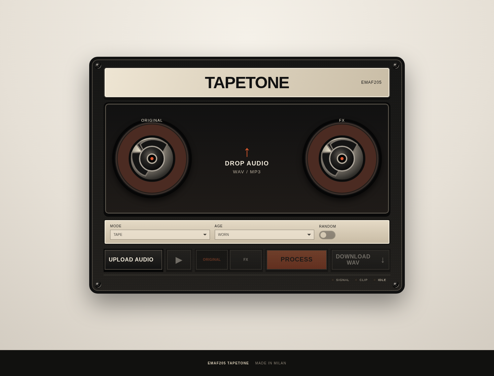
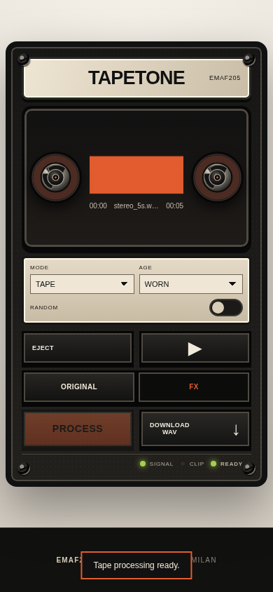

# TapeTone Player — Analog Cassette Nostalgia & Web Audio Synthesis

<p align="center">
  
</p>

> **"A love letter to the tactile warmth and mechanical soul of analog cassette decks."**  
> An experiential, client-side Web Audio player recreating the physical sensation of magnetic tape: spinning reel inertia, mechanical piano-key button clicks, customizable tape saturation, and ambient lo-fi acoustics.

[](https://emaf205-tapetone.netlify.app/)
[](https://github.com/emaf205/emaf205-tapetone)
[](LICENSE)

---

## ✦ The Genesis & Why This Exists

Modern music streaming interfaces have become sterile, hyper-optimized glass rectangles. You tap a frictionless digital surface, an algorithm plays a lossless audio stream, and the entire physical romance of listening to music evaporates.

Growing up with cassette tapes meant physical engagement:
- The heavy, satisfying mechanical clunk of pressing <kbd>PLAY</kbd> or <kbd>EJECT</kbd>.
- Watching two plastic reels rotate at slightly varying angular velocities as ribbon transfers from left to right.
- The warm, rounded low-end frequency profile shaped by magnetic tape heads and subtle tape hiss.

I built **TapeTone** to revive that physical intimacy on the web. It is not just an MP3 player wrapped in a skeuomorphic skin: it is a **procedural Web Audio acoustic engine** that models mechanical inertia, button travel, reel physics, and audio filtering in real time.

---

## ✦ Live Interface & Screenshots

<p align="center">
  
  
</p>

---

## ✦ Key Features

- **📼 Kinetic Cassette Reel Physics**:
  - Independent SVG spool animations that realistically calculate tape thickness and rotation speed as the track progresses.
  - Smooth deceleration and acceleration when pausing and resuming.
- **🔊 Procedural Mechanical Clicks**:
  - Zero external MP3 click samples. Audio clicks for buttons (<kbd>PLAY</kbd>, <kbd>STOP</kbd>, <kbd>PAUSE</kbd>, <kbd>FFWD</kbd>) are synthesized procedurally via the Web Audio API using micro-burst noise and low-pass resonant filter decay.
- **🎛️ Analog Tone & Tape Saturation**:
  - Optional lo-fi acoustic filter modeling subtle flutter, warm harmonic warmth, and high-shelf rolloff.
- **📁 Drag & Drop Local Audio**:
  - Drop your own audio tracks (`.mp3`, `.wav`, `.ogg`, `.flac`) directly onto the cassette window.
  - Zero server uploads: audio streams purely from local device storage.
- **📲 Mobile-First PWA**:
  - Fully responsive layout tuned for iPhone and Android touchscreens.
  - Works offline via Service Worker caching.

---

## ✦ Technical Highlights

```text
emaf205-tapetone/
├── index.html           # Semantic cassette deck chassis and tape window
├── styles.css           # Skeuomorphic plastic textures, reel geometry
├── app.js               # Web Audio API graph, mechanical audio synth, reel physics
├── manifest.webmanifest # PWA configuration
├── service-worker.js    # Offline asset caching
└── screenshots/         # Interface previews
```

- **Pure Vanilla Web Standards**: Zero React, zero Vue, zero heavy audio frameworks.
- **60 FPS Hardware-Accelerated Transforms**: Butter-smooth spinning reels rendered with CSS `will-change: transform`.

---

## ✦ Quickstart & Offline Execution

```bash
# Clone the repository
git clone https://github.com/emaf205/emaf205-tapetone.git
cd emaf205-tapetone

# Start any local HTTP server
python3 -m http.server 8080
```

Open [http://localhost:8080](http://localhost:8080) to load your cassette tape deck.

---

## ✦ Author & Credits

Designed and coded by **[Emanuele BDC](https://emaf205.com)** in Milan.  
Dedicated to analog enthusiasts, lo-fi producers, and anyone who misses the sound of a cassette clicking into place.

Distributed under the **MIT License**. Free for personal and creative listening.
